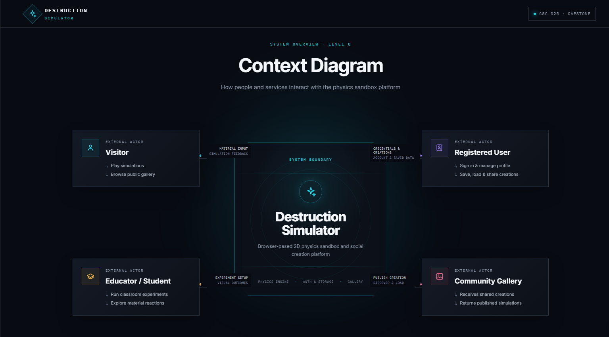

CSC325 Capstone project: "Destruction Simulator"

Inspired by the spirit of the popular game "Noita" developed by Nolla
Games, as well as "Powder Game" by Dan-Ball. Our Destruction Simulator
is a 2D physics simulator where users paint a canvas with different
materials (sand, wood, water, fire, gas) and watch them interact under
simple physical rules. Powders fall, water levels, fire spreads through
flammable materials, water puts out fire and creates steam, etc.

On top of the sandbox will be a web platform where users can sign
in, save and load creations, and browse a gallery of what other people
have built.

An app like this can target educational institutions to teach kids
about basic physics and chemistry fundamentals

...or just people trying to pass the time

Live app: https://destruction-simulator.onrender.com

---------------

FIGMA LINKS

PERSONAS: https://www.figma.com/design/7FzzH3n66YKb1FPM4prG6l/Physics-Sim-Personas?node-id=11-176&t=SuTJ6pSWSGlm0TZl-0

CONTEXT DIAGRAM: https://www.figma.com/make/jcddPTptLKNJQfWEi5Hvyt/Create-context-diagram?t=qVfd0emh5eyu0qZH-0

UI: https://www.figma.com/make/xS6UxVHHr78p1nfaqF6TAL/Sandbox-Physics-Game?t=DyWKRAVRFOV7XMHe-1

---------------

SCOPE/EPICS

The application will contain:
- A core simulation with a defined material set and interactions
- Build tools giving the player the ability to place, erase, play, pause, step, etc.
- Account system and authentication
- Save and load a creation through MongoDB
- Gallery to browse and open other users' shared creations
- AI/LLM feature? - possibly an autobuild or an interactions explainer
- Playable in the browser
- Anything else as long as we have time

MATERIAL EXAMPLES

Stone - An immovable material that blocks everything, acts as a wall
Sand - Falls and piles, also sinks through liquids
Water - Falls and levels, puts out fire
Fire - Spreads through flammable objects, becomes steam under water
Steam - Rises and dissipates
Wood - Burns and carries fire
Oil - Explodes if in contact with fire
and more depending on time

---------------

TEST PLAN OVERVIEW

Testing is split into two main categories, the client side simulation and the Django/Mongo backend,
with a final system test towards the end

1) Unit Tests: Simulation Engine
- The core grid update loop, material behaviors, and reactions
  Approach:
  - Build a small grid by hand (5x5, 10x10...), run the engine for N steps, compare the result to a known
    expected grid calculated by hand
  - Make sure we check properties that always hold, examples:
    a) Particle counts are conserved (ex. sand is never created or destroyed from thin air)
    b) Static materials (stone) never move.
    c) No particle can be updated more than once per tick
    d) Water in a closed container eventually must level out
  - Verify each defined interaction
    a) fire next to wood ignites it
    b) water next to fire extinguishes it
    c) etc
2) Integration Tests: API and Database
  Approach:
    - Round trip saving and loading: Save a scene through the API, load it back, confirm the returned
      document is identical to the original
    - Validation: Malformed or oversized scene documents must be rejected
    - Authentication: Protected endpoints reject unauthenticated requests, and users can't modify each other's
      saved scenes
3) Final System Test
  Approach:
    - A scripted checklist of what must work before finalizations
    - Stress testing

---------------

CI/CD PIPELINE

Our pipeline is a single GitHub Actions workflow at `.github/workflows/ci_cd.yml`.
It runs automatically on every push to `main` and every pull request into `main`.

The workflow has four stages that run in order. Each stage only starts if the one before it passed:

    Setup ──► Dependencies ──► Test ──► Deploy

1) Setup
   - Checks out the repository
   - Verifies the key project files exist (manage.py, requirements.txt, simulation/package.json,
     frontend/package.json)

2) Dependencies
   - Installs Python (version pinned in `.python-version`) and the packages in requirements.txt
   - Runs `pip check` to catch conflicting package versions
   - Installs Node.js 24 and runs `npm install` for the simulation engine and the frontend

3) Test
   - `python manage.py check` - Django system check
   - `python manage.py test` - backend tests (health endpoint, account management API, CSRF endpoint)
   - `npm test` in `simulation/` - simulation engine unit tests (grid, pixels, materials, world update rules)
   - `npm test` in `frontend/` - frontend brush/eraser tests

4) Deploy (only on a push/merge to main, never on a pull request)
   - Calls a private Render deploy hook, which tells Render to build and deploy the latest `main`
   - Polls the app's `/health/` endpoint until the commit the live site reports matches the commit
     that was just tested. If Render doesn't serve the new commit within 15 minutes, the stage fails

Hosting is configured in `render.yaml` (Render Blueprint) and built with `build.sh`. Render's own
auto-deploy is turned off, so the only way code reaches the live site is through this pipeline,
after the Test stage has passed.

---------------

BRANCH PROTECTION

The `main` branch is protected by a GitHub ruleset (Settings > Rules > Rulesets) that:

1) Blocks direct pushes to `main` - all changes must come in through a pull request
2) Requires a pull request with at least one approving review from a teammate before merging
3) Requires the "Test" status check from the CI/CD pipeline to pass before a pull request can be merged

This means nothing reaches `main` (and therefore nothing gets deployed) without a teammate's review
and a passing test suite.

---------------

SECRETS

No API keys, tokens or passwords are stored in the code, the workflow file, or the commit history.

| Secret | Where it is stored | Used by |
|---|---|---|
| `RENDER_DEPLOY_HOOK_URL` | GitHub Secrets (Actions) | Deploy stage, to trigger a Render deploy |
| `DJANGO_SECRET_KEY` | Render environment variable (generated by Render) | Django in production |
| `MONGODB_URI` | Render environment variable / local `.env` file (git-ignored) | Database connection |

Non-secret configuration such as the public app URL (`RENDER_APP_URL`) is stored as a GitHub Actions
variable. The workflow only references secrets via `${{ secrets.NAME }}`, and GitHub masks their values
in the logs. `.env` files are listed in `.gitignore` so local credentials are never committed.

---------------

RUNNING LOCALLY

Backend (user accounts are stored in MongoDB, so set `MONGODB_URI` first, e.g. a free
MongoDB Atlas cluster or `mongodb://localhost:27017` for a local server):

    pip install -r requirements-dev.txt
    export MONGODB_URI="mongodb+srv://..."   # PowerShell: $env:MONGODB_URI = "..."
    python manage.py migrate
    python manage.py runserver

Tests use an in-memory MongoDB (mongomock), so they don't need `MONGODB_URI`.

Frontend (http://localhost:8080):

    cd frontend
    npm start

Tests:

    python manage.py test
    cd simulation && npm test
    cd frontend && npm test
